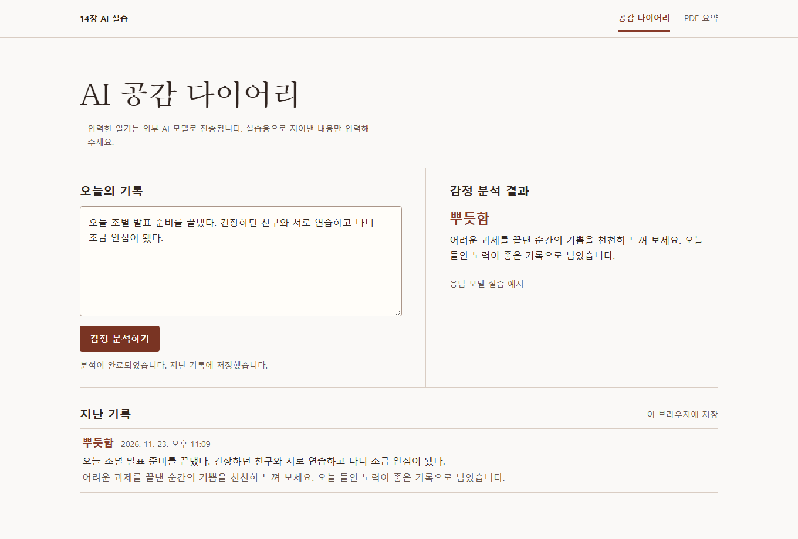
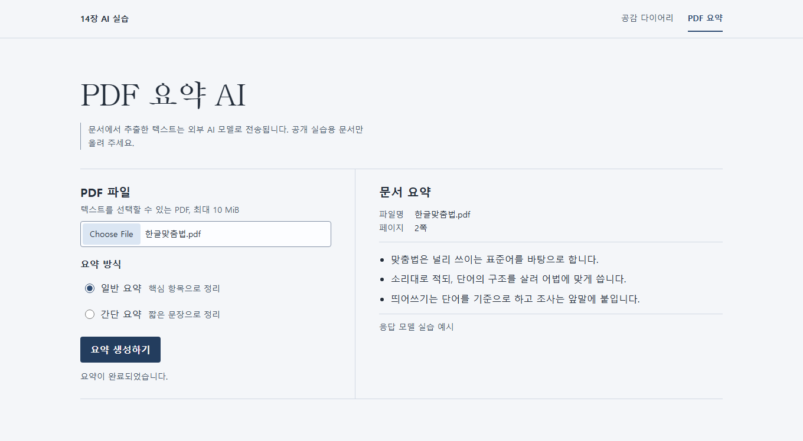

# Chapter 14 Assessment Exercise · Codex

[한국어](./README.md) | **English**

The AI Empathy Diary and AI PDF Summarizer run on the same local server. The exercise used five GPT-6.2 Sol roles during development. Both apps call the free NVIDIA Nemotron 3.5 Lightning model through OpenRouter.

## Run

Open the `Study-05` folder in Windows PowerShell and run the following commands.

```powershell
python -m pip install -r requirements.txt
python -B study_app.py --port 8766
```

- [AI Empathy Diary](http://127.0.0.1:8766/index.html)
- [AI PDF Summarizer](http://127.0.0.1:8766/index_pdf.html)

In the exercise environment, the server can read the key from the existing `Study-04/Api.env` file. In other environments, copy `.env.example` to `.env` and set `OPENROUTER_API_KEY`. The browser sends requests to the local server, which handles requests to the external model. Use fictional diary entries and public PDFs for this exercise.

## Try the apps

1. In the diary, enter the fictional sentence `오늘 팀 프로젝트 발표를 무사히 끝내서 뿌듯했다.` (I was proud that our team project presentation went well today.) and select **감정 분석하기** (Analyze emotion). Review the detected emotion and the Korean response. The browser stores recent entries.
2. In the PDF summarizer, select [한글맞춤법.pdf](https://github.com/taehojo/vibecoding/blob/master/%EC%9E%85%EB%A0%A5%EC%98%88%EC%A0%9C/%ED%95%9C%EA%B8%80%EB%A7%9E%EC%B6%A4%EB%B2%95.pdf), choose **일반 요약** (Standard summary), and select **요약 생성하기** (Generate summary). You can also run **간단 요약** (Brief summary) on the same file.

The sample came from the [textbook's official GitHub repository](https://github.com/taehojo/vibecoding/blob/master/%EC%9E%85%EB%A0%A5%EC%98%88%EC%A0%9C/%ED%95%9C%EA%B8%80%EB%A7%9E%EC%B6%A4%EB%B2%95.pdf). Its SHA-256 hash is `2237b331707cc8c87d202943284fcaf47624d0993a7ae5b80b9134820cc0c1d7`.

### Current app screens

These captures show a fictional diary entry and the textbook PDF in the browser, with sample model responses.





## Codex roles and assessment screenshots

See `.codex/agents/*.toml` for each role's model and instructions. Codex CLI ran in separate threads using those role configurations, and the screenshots attached to the release show the run history for each role. The work sessions used Codex's `workspace-write` permission.

| Assessment item | Evidence |
| --- | --- |
| 01–05 | Configuration and creation records for the PM, backend, frontend, QA, and AI integration roles |
| 06 | AI Empathy Diary development run |
| 07 | Emotion analysis in the diary using the live model |
| 08 | AI PDF Summarizer development run |
| 09 | Standard summary after uploading the official sample PDF |

The `study-05-evaluation-screenshots.zip` asset in the GitHub release contains nine PNGs in assessment order. The development screenshots show actual execution logs formatted for readability in a browser.

## Tests

Save `한글맞춤법.pdf` from the textbook repository as `samples/한글맞춤법.pdf` in this project, then run the following command.

```powershell
python -B -m unittest discover -s tests -v
```

The contract tests use the real local HTTP server and the official sample PDF, substituting only the external model. The archived assessment captures in the release show the full flow from the browser to the external model.
