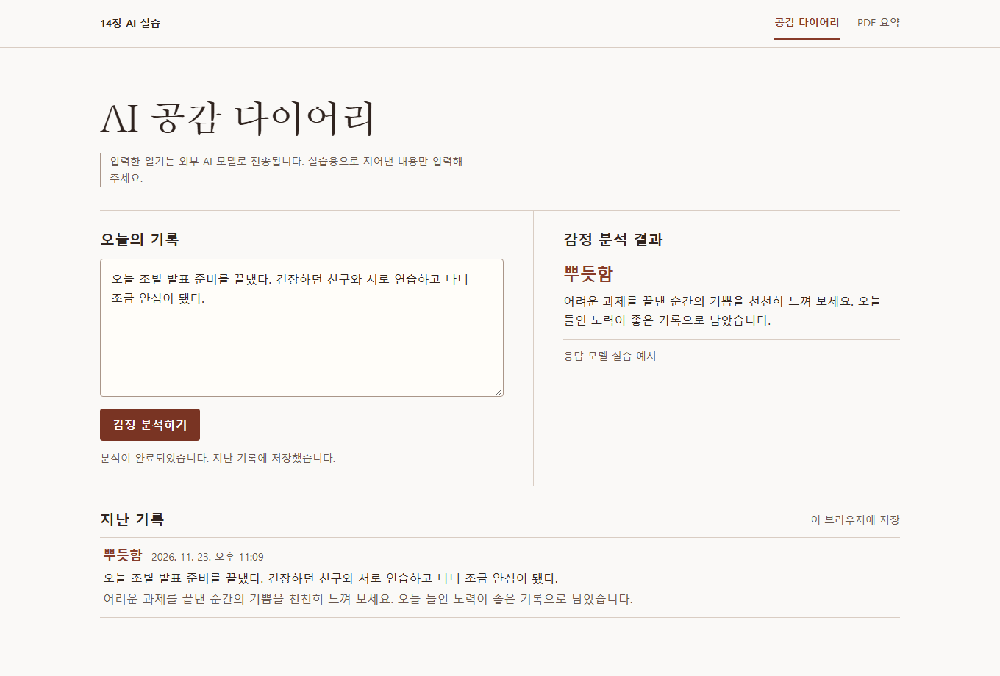
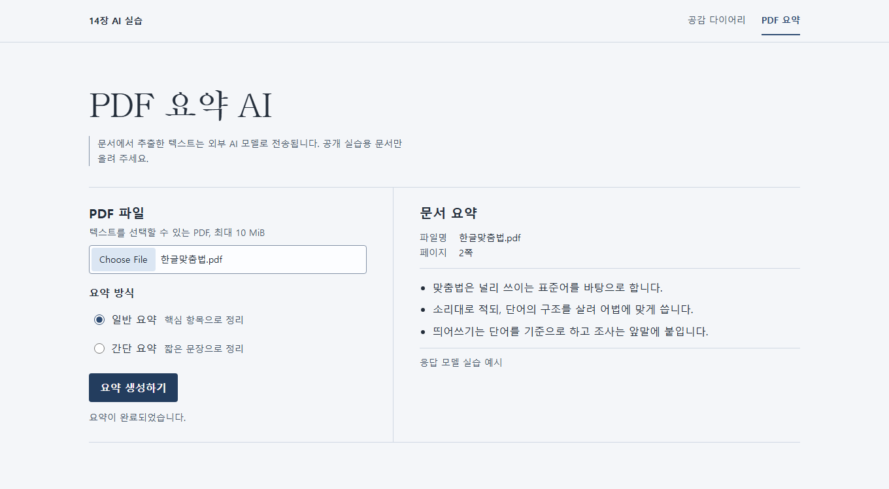

# 14장 평가 실습 · Codex

**한국어** | [English](./README.en.md)

AI 공감 다이어리와 PDF 요약 AI를 같은 로컬 서버에서 실행합니다. 개발에는 GPT-6.2 Sol 역할 5개를 사용하고, 두 앱은 OpenRouter의 NVIDIA Nemotron 3.5 Lightning 무료 모델을 호출합니다.

## 실행

Windows PowerShell에서 이 `Study-05` 폴더를 열고 다음을 실행합니다.

```powershell
python -m pip install -r requirements.txt
python -B study_app.py --port 8766
```

- [AI 공감 다이어리](http://127.0.0.1:8766/index.html)
- [PDF 요약 AI](http://127.0.0.1:8766/index_pdf.html)

현재 실습 환경에서는 기존 `Study-04/Api.env`의 키를 서버가 읽을 수 있습니다. 다른 환경에서는 `.env.example`을 `.env`로 복사하고 `OPENROUTER_API_KEY`를 입력합니다. 브라우저는 로컬 서버에 요청하고, 외부 모델 요청은 서버가 처리합니다. 실습에는 가상의 일기와 공개 PDF를 사용합니다.

## 앱 확인

1. 다이어리에 가상 문장 `오늘 팀 프로젝트 발표를 무사히 끝내서 뿌듯했다.`를 입력하고 **감정 분석하기**를 누릅니다. 감정과 한국어 공감 메시지를 확인합니다. 최근 기록은 브라우저에 저장됩니다.
2. PDF 요약 AI에서 [한글맞춤법.pdf](https://github.com/taehojo/vibecoding/blob/master/%EC%9E%85%EB%A0%A5%EC%98%88%EC%A0%9C/%ED%95%9C%EA%B8%80%EB%A7%9E%EC%B6%A4%EB%B2%95.pdf)를 선택하고 **일반 요약**으로 **요약 생성하기**를 누릅니다. 같은 파일로 **간단 요약**도 실행할 수 있습니다.

샘플은 [교재의 공식 GitHub 자료실](https://github.com/taehojo/vibecoding/blob/master/%EC%9E%85%EB%A0%A5%EC%98%88%EC%A0%9C/%ED%95%9C%EA%B8%80%EB%A7%9E%EC%B6%A4%EB%B2%95.pdf)에서 받았습니다. SHA-256은 `2237b331707cc8c87d202943284fcaf47624d0993a7ae5b80b9134820cc0c1d7`입니다.

### 현재 앱 화면

가상의 일기와 교재 PDF를 브라우저에서 사용해 촬영했습니다. 모델 응답은 화면 설명용 예시입니다.





## Codex 역할과 평가 캡처

역할별 모델과 지시는 `.codex/agents/*.toml`에서 확인할 수 있습니다. 역할 설정을 읽어 Codex CLI를 독립 스레드로 실행했고, 역할별 실행 기록은 릴리스에 첨부한 캡처에서 확인할 수 있습니다. 작업 세션에는 Codex의 `workspace-write` 권한을 적용했습니다.

| 평가 번호 | 증거 |
| --- | --- |
| 01–05 | PM, 백엔드, 프런트엔드, QA, AI 연동 역할 설정과 생성 기록 |
| 06 | AI 공감 다이어리 개발 실행 기록 |
| 07 | AI 공감 다이어리에서 실제 모델로 감정 분석한 결과 |
| 08 | PDF 요약 AI 개발 실행 기록 |
| 09 | 공식 샘플 업로드 후 일반 요약을 실행한 결과 |

GitHub 릴리스의 `study-05-evaluation-screenshots.zip`에 평가 순서대로 PNG 9장이 들어 있습니다. 과정 캡처는 실제 실행 로그를 브라우저에서 읽기 좋게 표시한 화면입니다.

## 테스트

교재 자료실에서 받은 `한글맞춤법.pdf`를 이 프로젝트의 `samples/한글맞춤법.pdf`로 저장한 뒤 실행합니다.

```powershell
python -B -m unittest discover -s tests -v
```

계약 테스트는 실제 로컬 HTTP 서버와 공식 PDF를 사용하며 외부 모델만 대체합니다. 릴리스에 보관한 평가 캡처에는 브라우저에서 외부 모델까지 연결한 결과가 담겨 있습니다.
